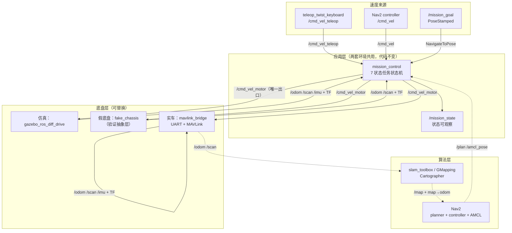

# ROS 小车项目 · 简历素材库

> **用途**：改简历时的唯一信息来源。所有数字、模块、难点都从这里取，避免口述时前后矛盾。
> **结构**：先看「一句话版本」和「量化成果」，写简历时按需下钻到分项。
> **证据等级标注**（重要，面试被追问时按这个说）：
> - 🟢 **实测**：本机跑过、有工具输出或日志
> - 🔵 **代码事实**：读了源码/配置/launch 确认，未运行
> - 🟡 **口述**：本人确认完成，但无留存的量化数据
> - ⚪ **设计**：写了但未在真实硬件上验证

---

## 一、一句话版本

**面向室内场景的 ROS 2 差速移动机器人系统，覆盖「仿真闭环 → 实车跑通」两套环境；独立完成 URDF 建模、传感器接入、SLAM 建图、Nav2 导航、任务状态机与安全层、启动整合与回归测试。**

一句话（简历标题行用）：

> 基于 ROS 2 + Gazebo + Nav2 的差速移动机器人：从仿真闭环到实车部署，自研 7 状态任务状态机与安全层（唯一速度出口 / 急停 / 看门狗 / 迁移表）。

---

## 二、项目定位与范围

| 维度 | 仿真环境 | 实车环境 |
|---|---|---|
| 平台 | WSL2 / Ubuntu 22.04 / ROS 2 Humble | 树莓派等上位机 + ESP32-S3 底盘 |
| 物理引擎 | Gazebo Classic 11 | 真实差速底盘（编码器 + IMU + 电机 PID） |
| 底盘接口 | `gazebo_ros_diff_drive` 插件 | 自研 MAVLink 桥（串口 `/dev/ttyUSB0`） |
| 感知 | Gazebo 射线雷达 10Hz + IMU 100Hz | Camsense 2D 雷达 + IMU + 摄像头 |
| 建图 | slam_toolbox | GMapping / Cartographer（两套） |
| 导航 | Nav2（自定义 params） | Nav2（含 EKF 融合 + 3 张地图） |
| 人机交互 | RViz2 + 终端 | Qt5 上位机（地图/雷达/代价地图/视频） |
| 状态 | ✅ 全链路跑通 🟢 | ✅ 底盘跑动 + 建图导航链路 🟡 |

**两套环境共用同一套上层接口**（`/odom`、`/scan`、`/imu`、`/map`、`/cmd_vel`、TF 树），
这是本项目的核心工程价值：**换硬件不动应用层**。

---

## 三、系统架构

### 3.1 整体数据流（仿真 / 实车同一张图，只换底盘）



### 3.2 TF 树（三坐标系，全项目的地基）

```
map ──────► odom ──────► base_footprint ──────► base_link ──┬─► laser_frame
│            │                │                              ├─► imu_link
│            │                │                              └─► 左右轮
│            │                └─ robot_state_publisher（URDF fixed joint）
│            └─ 底盘驱动 / Gazebo 插件（轮子积分，50Hz）
└─ SLAM 或 AMCL（修正量，允许跳变）
```

**为什么三个**：`map→odom` 在重定位时会跳变，若控制器直接用 `map→base_link` 会看到位置瞬移、输出巨大速度；用 `odom` 做缓冲层，控制器只吃连续的 `odom→base_link`。

---

## 四、核心工作分项

### 4.1 机器人建模与参数化（仿真）

- 用 **xacro** 参数化整车：轮半径 `0.0325`、轮距 `0.17`、车体 `0.20×0.15×0.08`、万向轮、雷达/IMU 安装位
- 改一个数字整车跟随变化（改轮距后轮子自动外移）
- 处理 **fixed joint 与 movable joint 的 TF 发布方式差异**（RSP vs joint_state_publisher）
- 雷达加 **20mm standoff**，解决「雷达扫到车体自身」的虚假近距点（0.075/0.100m）

🟢 静态检查：`xacro` 展开无报错；RViz 中 link 树与实测尺寸一致

### 4.2 传感器接入（仿真）

- 2D 雷达：360 线、10Hz、量程 0.05–12m，输出 `/scan`
- IMU：100Hz，输出 `/imu`
- 关键认知：**Gazebo 传感器 ≠ ROS 话题**，中间要挂 `libgazebo_ros_ray_sensor.so` 等插件
- 空世界里 `/scan` 全 `inf` 是几何必然（水平射线与地面平行无交点），不是故障

🟢 实测：`ros2 topic hz /scan` ≈ 10Hz，`/imu` ≈ 100Hz

### 4.3 SLAM 建图与 Nav2 导航（仿真 + 实车）

**仿真**

- slam_toolbox 在线异步建图，产出 `my_map.pgm/.yaml`（83×83，4m×4m 房间）
- Nav2 参数按本车标定，解决三个真实故障：

| 故障 | 根因 | 修法 |
|---|---|---|
| Nav2 报 `SUCCEEDED` 但车不动 | AMCL `update_min_d=0.25` → 车静止时 TF 时间戳变旧 | `update_min_d/a = 0.0` + `transform_tolerance=1.0` |
| 有绿色路径但车不动 | 目标距车 < `xy_goal_tolerance`(0.25) | 点远目标 |
| `inflation_radius` 默认 0.55 把 4m 房间堵死 | 膨胀层过大 | 按车外接圆 0.125 设为 0.30 |

**实车**（🔵 代码事实 + 🟡 跑通）

- 两套建图方案：GMapping（粒子滤波）、Cartographer（回环 + 图优化）
- Nav2 配置含 **EKF 传感器融合**（`robot_localization`，融合轮速 odom + IMU）
- 3 张场景地图（`maps/` 下 jia1/room/room1）

### 4.4 任务状态机与安全层（本项目的增量核心）

> 这是原有实车项目**完全缺失**的一层，也是简历里最能与"只会跑 demo"区分开的部分。

**7 个状态**

| 状态 | 语义 | 听哪个速度源 | 速度放行 |
|---|---|---|---|
| `IDLE` | 待机 | 无 | ❌ |
| `TELEOP` | 遥控 | `/cmd_vel_teleop` | ✅ |
| `MAPPING` | 建图中（人开车扫图） | `/cmd_vel_teleop` | ✅ |
| `LOCALIZING` | 重定位（人点初始位姿） | 无 | ❌ |
| `NAVIGATING` | 自主导航 | `/cmd_vel`（Nav2） | ✅ |
| `ESTOP` | 急停，**粘性** | 无（20Hz 压零速） | ❌ |
| `ERROR` | 故障，**粘性** | 无（20Hz 压零速） | ❌ |

**五个机制**

| 机制 | 实现 | 解决什么 |
|---|---|---|
| **唯一速度出口** | 底盘插件 `cmd_vel` remap 到 `/cmd_vel_motor`，状态机成为唯一发布者 | 多源抢话题导致急停被覆盖 |
| **迁移表 + 准入检查** | 从某状态能去哪些状态硬编码；进运动态前查数据健康 | TELEOP 直跳 NAVIGATING 会带残留速度；数据未就绪先进后报错 |
| **速度源分权** | 每个状态只接受一个源（teleop / nav），其余拦截计数器 | 导航时键盘仍能抢方向盘 |
| **急停** | 进入时立刻发零速 + 20Hz 持续压 + 粘性（只能 RESET 解除） | 底盘保持最后速度，"停发"不等于"发零速" |
| **看门狗** | `/odom` 0.5s、`/scan` 1.0s 超时 → ERROR；故障未消除拒 RESET | 底盘/雷达掉线时上层仍"正常"发速度 |

**关键设计决策（面试可讲）**

- **白名单而非黑名单**：漏写一个状态时默认"不放行"，车不动而不是乱跑（fail-closed）
- **粘性急停**：安全动作不能被下一个命令冲掉，必须显式 RESET
- **ERROR 不自动恢复**：故障可能间歇性（接触不良、偶发丢包），自动恢复等于让车自己开始动
- **看门狗只在工作态监控**：IDLE 待机允许底盘断电，不该误报

🟢 实测数据

| 指标 | 结果 |
|---|---|
| 急停延迟（0.3 m/s） | **310 ms**，多走 **48.2 mm**（与 `max_wheel_acceleration=1.0 m/s²` 推导一致） |
| 急停压零速频率 | **20 Hz**（日志时间戳对齐：2 秒 40 帧） |
| 看门狗触发 | 杀 gzserver 后 **0.56 s** 进 ERROR |
| 分权拦截 | TELEOP 下 nav 源位移 −0.000 m；NAVIGATING 下 teleop 源 −0.001 m |
| 导航闭环 | 目标 (1.2,1.0) → 剩余距离 1.95→0.59 m → SUCCEEDED → 回 IDLE |
| 取消导航 | `导航已取消` 回调触发，车停住（位移 1mm 级） |

### 4.5 启动整合与参数化

- `bringup.launch.py`：**一条命令**起 Gazebo + 状态机（复用而非复制 `gazebo.launch.py`）
- 参数：`sim`、`gui`、`world`、`initial_state`、`grace_period`、`namespace`
- **`sim:=true/false` 切换底盘**：仿真用 Gazebo 插件，非仿真用 `fake_chassis`（自研假底盘），状态机零改动
- 踩过并修复：`initial_state:=TELEOP` 若不同时加大 `grace_period`，Gazebo 还没 spawn 完就被看门狗判超时 → ERROR

🟢 实测：`initial_state:=TELEOP grace_period:=25` → 状态直达 TELEOP，发 0.3 m/s 走 1.33 m；
`sim:=false` → 无 gzserver，仅 3 节点，odom 0→1.242 m

### 4.6 回归测试（可重复验收）

`scripts/regression.sh`：**11 项自动断言**，一条命令跑完（假底盘约 60s）

覆盖：节点齐全 / 初始状态 / 闸门拦截 / IDLE→TELEOP / TELEOP 能动 / 分权拦截 / ESTOP 进入 / ESTOP 压零速 / 急停粘性 / RESET / 看门狗进 ERROR

```
通过 11 项，失败 0 项 ✅
```

**设计原则**：每步独立判定失败不中断；只用 ROS 2 CLI + timeout；`trap cleanup EXIT` 不留孤儿；数值判定用阈值不用精确值。

**脚本自身踩的两个坑**（体现测试也要被测试）：
1. `节点数 >= 3` 误写成严格大于 → 断言错，不是系统错
2. `SIGSTOP` 冻结进程触发 Fast DDS 共享内存端口冲突 → 改 `FASTDDS_BUILTIN_TRANSPORTS=UDPv4` + 用 `kill` 替代

### 4.7 实车：MAVLink 通信桥（C++）

🔵 代码事实（源码 + 参数声明已核）

- 订阅 `/cmd_vel`，转 MAVLink 运动指令经串口下发；接收底盘回传，转标准消息：
  `nav_msgs/Odometry`、`sensor_msgs/Imu`、`sensor_msgs/LaserScan`
- 参数化设计：`port`（`ttyUSB0`）、`cmd_vel_topic`、`odom_topic`、`scan_topic`、`imu_topic`、
  `odom_frame_id`、`base_frame_id`、`imu_frame_id`、`scan_frame_id`
- 处理 **FRD/FLU 坐标系差异**、雷达角度方向、**分片雷达数据缓存与完整扫描拼接**
- 通信线程 + 重连机制，提升断连恢复能力

**协议分层（面试必答）**：ROS 2 侧 DDS（默认 UDPv4）；底盘侧 UART + MAVLink（不是 TCP/UDP）。

### 4.8 实车：雷达驱动、摄像头、Qt 上位机

- **`camsense_lidar`**：串口读取 → 帧解析 → 距离/角度/量程处理 → 角度重排 → 发布 `/scan`
- **`xuegecar_camera`**：ESP32 HTTP/MJPEG → `CompressedImage` 话题
- **`xuegecar_qt_gui`**：C++/Qt5，显示地图/雷达/全局与局部路径/两张代价地图/摄像头/电压电量；
  键盘遥控（W/S/A/D + Space 急停）；地图拖拽发目标、设初始位姿；**独立 ROS executor 线程**避免回调阻塞 GUI；TF2 统一坐标
- **`xuegecar_servo_qt_gui`**：舵机云台调试
- **`leap_interfaces`**：速度 PID 参数读写服务

---

## 五、量化成果汇总（写简历时优先用这张表）

| # | 成果 | 数字 | 证据 |
|---|---|---|---|
| 1 | 仿真全链路闭环 | 11 个阶段，从空白工作区到 Nav2 自主导航 | 🟢 |
| 2 | 状态机规模 | **7 状态 / 5 安全机制**（闸门、迁移表、分权、急停、看门狗） | 🟢 代码 + 实测 |
| 3 | 急停响应 | 0.3 m/s 下 **310 ms / 48.2 mm** | 🟢 探针实测 |
| 4 | 急停零速保持 | **20 Hz** 持续压制 | 🟢 日志时间戳对齐 |
| 5 | 看门狗响应 | 数据中断后 **0.56 s** 进 ERROR | 🟢 实测 |
| 6 | 回归测试 | **11 项断言，全部通过** | 🟢 脚本输出 |
| 7 | 启动复杂度 | 4 终端 4 命令 → **1 条命令** | 🟢 |
| 8 | 抽象层切换 | 换底盘 **0 行应用层代码改动** | 🟢 `sim:=false` 实测 |
| 9 | 多车隔离 | 2 套实例并行，速度互不串（odom 0→1.206 m vs 0.000 m） | 🟢 实测 |
| 10 | 实车软件规模 | **13 个功能包**（驱动/两套 SLAM/Nav2/GUI/接口） | 🔵 磁盘核实 |
| 11 | 实车地图 | **3 张**场景地图 | 🔵 |
| 12 | 实车跑通 | 底盘跑动 + 建图 + 导航链路 | 🟡 口述 |

---

## 六、难点与解决方案（面试追问的主力）

### 难点 1：急停"发了但停不住"

**现象**：切出 `TELEOP` 后车还在滑，实测 4 秒滑 0.6 米。

**根因**：底盘（插件/固件）没有"命令过期"概念，会一直执行最后一条速度。"不再转发"≠"发零速"。

**解法**：进入非放行状态时**立刻**发一帧零速覆盖残留，并在 `ESTOP/ERROR` 里以 **20 Hz 持续压**；周期比任何速度源都密，同时覆盖"单帧丢失"和"刚发出去还没生效"两个窗口。

**验证**：0.3 m/s 触发急停，首次观测 `|vx|<0.01` 用 **310 ms**，与底盘加速度限幅 `1.0 m/s²` 的推导（0.3÷1.0）吻合。

### 难点 2：Nav2 报成功但车没动（假成功）

**现象**：发目标后 **60 ms** 返回 `SUCCEEDED`，`/plan` 有 194 个点、终点正确，`/amcl_pose` 在原点。

**排除链**：目标在脚下（否）→ 传参错误（否，探针复现 Nav2 收到 `distance_remaining=1.9485`）→ 多实例（否）→ **`goal_checker.stateful: true`**（是）。

**根因**：`SimpleGoalChecker` 在 stateful 模式下"一旦判定到达就永远返回 true，直到 reset"。

**解法**：改 `stateful: false`，**必须重启 Nav2**——`ros2 param set` 返回 successful 也不生效，因为插件在 configure 时把参数读进成员变量。

**加固**：成功时用 `amcl_pose` 与目标交叉核对，偏差 >0.8 m 打「疑似假成功」警告。

### 难点 3：同一条速度话题多个发布者

**现象**（两个阶段各出现一次）：
1. 状态机与 teleop 抢 `/cmd_vel` → 急停失效
2. 误开 3 个 `mission_control` → 车一顿一顿、`.echo` 随机命中、日志与实际不一致

**解法**：
- 结构上：底盘只订阅 `/cmd_vel_motor`，状态机是唯一发布者（`remapping`）
- 运行上：启动自检 `count_publishers('cmd_vel_motor') > 1` → FATAL 退出

### 难点 4：参数传了但没生效

| 场景 | 真相 |
|---|---|
| `ros2 param set` 返回 successful，行为不变 | 插件 configure 时读过一次成员变量，之后不再读参数服务器 |
| `initial_state:=TELEOP` 启动仍是 IDLE | 节点没声明该参数（旧代码），launch **静默忽略** |

**纪律**：改完参数第一件事永远是 `ros2 param get` 确认节点真的认领了。

### 难点 5：进程杀不干净

`pkill -f nav2_bringup` 之后 `controller_server` 仍在——因为 Nav2 节点跑在 `component_container_isolated` 里，**进程名不含上层关键词**。实测抓到一个 **17 分钟**的孤儿容器，正是假成功的元凶。

### 难点 6：观测手段污染结论（三次）

| 次数 | 错误手法 | 假结论 | 真相 |
|---|---|---|---|
| 1 | 用撞墙后的数据测急停 | "切 IDLE 车立刻停了" | 车早已顶在墙上 |
| 2 | 伪终端立即送按键 | "状态机把 teleop 也拦了" | teleop 还没进 raw 模式 |
| 3 | `SIGSTOP` 冻结仿真测恢复 | "恢复后车不能动" | 冻结导致仿真时钟跳变，是脚手架副作用 |

**共性**：验证装置和被测对象共享了状态。**测试代码也是系统的一部分，也会坏，而且坏起来更像被测对象坏了。**

---

## 七、简历文案（三档长度，直接取用）

### 7.1 一行版（简历技能栏 / 项目列表）

> **ROS 2 差速移动机器人（仿真 + 实车）**｜自研 7 状态任务状态机与安全层（唯一速度出口 / 急停 / 看门狗），急停实测 310 ms；一条 launch 起全套，回归脚本 11 项自动验收。

### 7.2 三行版（项目栏 3~4 行）

> - 基于 ROS 2 + Gazebo + Nav2 完成差速机器人从仿真到实车的完整链路：URDF/xacro 建模、雷达与 IMU 接入、slam_toolbox/GMapping/Cartographer 建图、Nav2 定位规划控制。
> - 自研 `mission_control` 任务状态机（7 状态 + 迁移表 + 速度源分权），解决"多节点抢 `/cmd_vel` 导致急停失效"的工程问题；急停实测 310 ms、20 Hz 持续压零速、看门狗 0.56 s 内进故障态。
> - 设计 `sim:=true/false` 底盘抽象与 `fake_chassis` 验证桩，实现**换硬件零改动应用层**；编写 11 项回归脚本，覆盖率安全层全部关键行为。

### 7.3 完整段落版（项目详情 8~12 行）

> **基于 ROS 2 的差速移动机器人系统（仿真 + 实车）**
>
> 面向室内场景，独立完成一套 ROS 2 差速机器人的仿真闭环与实车部署。仿真侧基于 Gazebo Classic 搭建最小闭环：xacro 参数化整车、差速插件驱动、2D 雷达与 IMU 接入、slam_toolbox 建图、Nav2 自主导航，并逐个排掉 AMCL 更新阈值导致"假到达"、代价地图膨胀半径过大堵死通道等真实故障。
>
> 应用层自研任务状态机 `mission_control`：定义 IDLE/TELEOP/MAPPING/LOCALIZING/NAVIGATING/ESTOP/ERROR 七状态与迁移表，做准入检查（数据不健康拒绝进运动态）；把底盘入口收敛为唯一 `/cmd_vel_motor`，按状态分权（遥控听 `/cmd_vel_teleop`、导航听 `/cmd_vel`），从根本上消除"多发布者抢话题导致急停被覆盖"；急停采用"立刻零速 + 20 Hz 持续压 + 粘性锁定"，实测 310 ms 停住（0.3 m/s，与底盘加速度限幅推导一致）；看门狗分源监控 odom/scan，超时自动进 ERROR 并要求故障消除后才能复位。
>
> 工程化方面，用一条 `bringup.launch.py` 起全套并参数化 `initial_state`/`grace_period`/`namespace`；设计 `sim:=true/false` 底盘抽象与 `fake_chassis` 验证桩，实现换硬件不改应用层代码；编写 11 项回归脚本（闸门/迁移/分权/急停/看门狗），作为每次改动后的验收基线。
>
> 实车侧参与 ROS 2 与 ESP32-S3 底盘的 MAVLink 通信桥（C++）：订阅 `/cmd_vel` 转 MAVLink 帧经串口下发，解析底盘回传的里程计/IMU/分片雷达数据并转标准消息，处理 FRD/FLU 坐标系与雷达角度方向差异；配合 GMapping/Cartographer 两套建图、Nav2 + EKF 融合导航，以及 C++/Qt5 上位机（地图、雷达、代价地图、视频、键盘遥控与急停）。

### 7.4 技能关键词（给 HR 筛简历用，按需勾选）

```
语言：C++ / Python
框架：ROS 2 (Humble)、rclcpp、rclpy、TF2、Nav2、Gazebo Classic
建图定位：slam_toolbox、GMapping、Cartographer、AMCL、robot_localization(EKF)
接口协议：MAVLink、UART、DDS、QoS 调优
嵌入式：ESP32-S3、ESP-IDF、FreeRTOS
上位机：Qt5 / QImage / 多线程 executor
工程化：colcon、ament_cmake / ament_python、xacro、launch 参数化、回归脚本
```

---

## 八、诚实边界（被追问时照这个说）

**能说"实测"的**（🟢）：仿真环境下的急停 310ms、看门狗 0.56s、分权拦截、导航闭环、`sim:=false` 零改动、两车隔离、回归 11 项。

**只能说"读过代码/配置"的**（🔵）：实车 MAVLink 桥的参数字段、13 个包的职责划分、3 张地图、EKF 配置文件存在。

**只能说"完成过、未留存量化数据"的**（🟡）：实车底盘跑动、实车建图与导航链路的实际精度/成功率。

**不能说"已验证"的**（⚪）：实车上的急停响应时间、看门狗在真实硬件抖动下的阈值是否合适、多车 TF 前缀方案的实际运行（只做了话题层隔离）。

**如果面试官问"实车安全层上线了吗"**，准确回答：
> 「实车项目原有代码没有状态机和安全层，我是在仿真里完整实现并验证的；迁移到实车只需把 launch 里 `fake_chassis` 换成 `mavlink_bridge`、把 `cmd_vel_topic` 参数指向 `/cmd_vel_motor`，应用层代码零改动——但这一步我尚未在真实硬件上跑通。」

---

## 九、这份文档怎么用

| 场景 | 取哪一节 |
|---|---|
| 写简历项目栏 | 七、7.2 或 7.3 |
| 投递前核对关键词 | 七、7.4 |
| 面试自我介绍 | 一、一句话版本 + 五、量化成果前 5 行 |
| 被问"最难的点" | 六、难点 1 或 2（有完整排除链） |
| 被问"你怎么保证可靠性" | 四、4.4 五个机制 + 4.6 回归脚本 |
| 被问"实车做到什么程度" | 二、范围表 + 八、诚实边界 |

**改简历时的纪律**：凡是这张表里标 🟢 的可以写"实测"，标 🟡 的写"完成"，标 🔵 的写"设计/配置"，标 ⚪ 的不写进简历。
