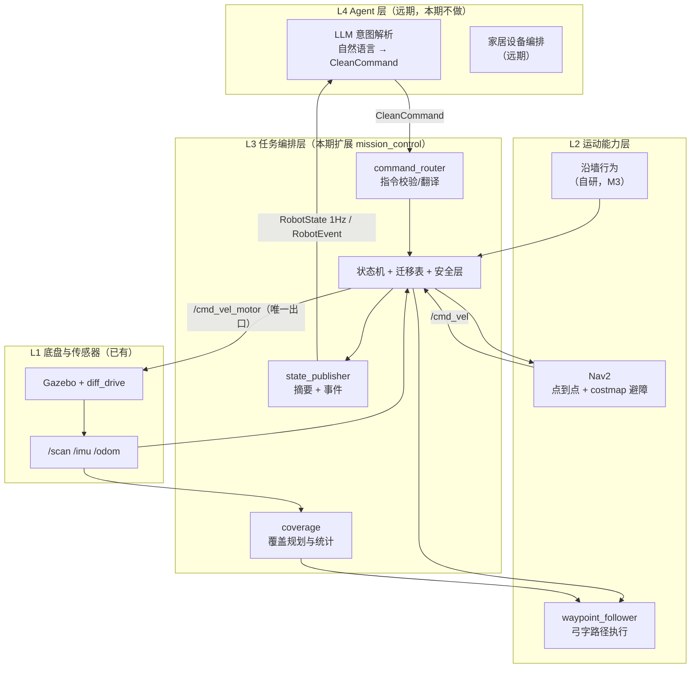

# 扫地机器人分支改造计划（M0–M4）

> **本文档是什么**：施工蓝图，不是讲义。写给「现在动手改」和「三个月后回来接着改」的同一个你。
>
> **一句话目标**：把已有仿真小车改造成能在三室一厅里自主建图、避障、覆盖清扫、自动回充的扫地机器人；所有对外交互按契约预留，将来接 LLM agent 时**机器人侧零改动**。
>
> **上游文档**：`阶段8接续说明.md`（阶段 0–11 已完成的状态）、`ROS2小车仿真搭建教学.md`（原理与实测细节）。

---

## 一、目标与非目标

### 目标（本期）

1. 三室一厅仿真环境（12m×10m，客厅 + 三个房间 + 走廊）
2. 自主建图 → 保存地图 → 定位 → 跨房间导航
3. 静态障碍避让 + 动态障碍绕行 + 卡住检测
4. 覆盖清扫（弓字路径 + 沿墙），可量化覆盖率
5. 自动回充（低电量触发 → 导航到桩 → 低速对接）
6. 对外发布结构化状态与事件，接收结构化指令

### 非目标（本期明确不做）

| 不做 | 原因 |
|---|---|
| 实车改造 | C 盘 `xuegeros_ws` 13 包只读参考，硬件风险不在本期 |
| 真实清洗物理 | 吸力/尘盒只做状态模拟，不做流体或接触仿真 |
| LLM agent 本体 | 文档第七章只写接入路径，本期不写代码 |
| 家居设备控制 | 同上，留接口不做实现 |
| 多机协同 | 阶段 9.4 的 namespace 能力先放着 |

---

## 二、现状基线（已核实，不是回忆）

| 项 | 事实 | 出处 |
|---|---|---|
| 状态机 | 7 状态：`IDLE` / `TELEOP` / `MAPPING` / `LOCALIZING` / `NAVIGATING` / `ESTOP` / `ERROR`，另有 `RESET` 命令 | `mission_control.py` L38–66、L342–376 |
| 唯一速度出口 | 底盘听 `/cmd_vel_motor`；`VELOCITY_ALLOWED = set(SOURCE_BY_STATE)`（白名单 fail-closed） | `mission_control.py` L38–41 |
| 速度源分权 | `TELEOP`/`MAPPING` 听 `teleop`（`/cmd_vel_teleop`），`NAVIGATING` 听 `nav`（`/cmd_vel`） | `mission_control.py` L36–40 |
| 迁移表 | `IDLE` → 四个状态；其余只能回 `IDLE`；`ESTOP`/`ERROR` 粘性，只能 `RESET` | `mission_control.py` L42–50 |
| 看门狗 | `MONITORED=('odom','scan')`，odom 0.5s / scan 1.0s 超时进 `ERROR`，10Hz 检查 | `mission_control.py` L56–58 |
| 安全频率 | 20Hz 压零速 | `SAFETY_HZ = 20.0` |
| 车体 | 0.20×0.15×0.08 m，轮距 0.17，轮半径 0.0325，质量 1.0 kg | `xuegecar_sim.urdf.xacro` L14–21 |
| 传感器 | 雷达 360 线 / −180°~180° / 0.05–12.0 m / 10 Hz；IMU 100 Hz | xacro L40–51 |
| Nav2 | `xy_goal_tolerance` 0.25、`yaw_goal_tolerance` 0.25、`inflation_radius` 0.30、`cost_scaling_factor` 3.0、static+obstacle+voxel 三层 costmap | `nav2_params.yaml` L124–258 |
| 地图 | `my_map` 83×83 @ 0.05 m/格（≈4.15 m 见方） | `~/my_map.yaml` |
| 环境 | `room.world` 4×4 m，5 个 model | `xuegecar_sim_bringup/worlds/room.world` |
| 回归 | `scripts/regression.sh` 11 项断言 | `xuegecar_sim_bringup/scripts/` |
| 可用 Nav2 组件 | `nav2_waypoint_follower`、`nav2_collision_monitor`、`slam_toolbox` 均已安装（source 后实测 328 个包） | `ros2 pkg list` |
| 代码版本 | `~/xuegecar_sim_ws` **不是 git 仓库**（`fatal: not a git repository`） | 实测 |

**一句话结论**：现有 `mission_control.py` 489 行不是「阶段 8 的作业」，而是一个可扩的任务编排层雏形——加状态、加能力，不重写。

---

## 三、目标架构



### 三条硬约束（后续任何改动都不得违反）

1. **Agent 永远不发 `/cmd_vel`**，也不直接调 Nav2 action。它只能发 `CleanCommand`。
2. **`/cmd_vel_motor` 仍是唯一速度出口**，所有速度必须经 `mission_control._gate`。
3. **Agent 通道不能发 `RESET`**。急停（`ESTOP`）它可以发，恢复必须由人确认——故障是否消除是人的判断，不是模型的。

---

## 四、接口契约（本期就要落地，实现可以后补）

### 4.1 新建包 `xuegecar_sim_interfaces`

理由：契约要先物化。用 `std_msgs/String` 拼 JSON 能跑，但没类型约束、agent 端和机器人端要各自手写解析，将来对接必然漂移。建一个 ament_cmake 的纯 msg 包，两端共享同一份定义，改字段时编译期就能发现不一致。

```
xuegecar_sim_interfaces/
├── msg/CleanCommand.msg
├── msg/RobotState.msg
├── msg/RobotEvent.msg
├── CMakeLists.txt
└── package.xml
```

**本期只建消息定义 + 一个把 `CleanCommand` 翻译成内部动作的 `command_router`，不实现 agent。**

### 4.2 `CleanCommand.msg`（agent → 机器人）

```
# 幂等键：同一个 task_id 重复下发不重复执行
string task_id
# START_CLEAN | PAUSE | RESUME | STOP | DOCK | QUERY
string command
# 房间名列表，空 = 全屋。房间名由 rooms.yaml 定义
string[] rooms
# 清扫遍数：0 或 1 = 单遍，2 = 两遍
uint8 repeat
# 任务超时秒数，0 = 用默认（单房间 300s / 全屋 1800s）
float32 timeout_s
```

| command | 语义 | 允许的前置状态 | 幂等 | 边界条件 |
|---|---|---|---|---|
| `START_CLEAN` | 开始清扫（`rooms` 空则全屋） | `IDLE` | 同 `task_id` 重复 = 忽略 | 房间名不在 `rooms.yaml` → 拒收；已有任务在跑 → 拒收 |
| `PAUSE` | 暂停，任务保留，原地停车 | `CLEANING` / `DOCKING` | 是 | 已在 `PAUSED` → 忽略 |
| `RESUME` | 继续未完成任务 | `PAUSED` | 是 | 无保留任务 → 拒收 |
| `STOP` | 终止任务，丢弃进度，回 `IDLE` | `CLEANING` / `PAUSED` / `DOCKING` | 是 | **不是急停**，不阻断后续指令 |
| `DOCK` | 返回充电桩（可从中断任务状态进入） | `IDLE` / `PAUSED` / `CLEANING` | 是 | 已在 `DOCKING` → 忽略；对接失败 3 次 → `ERROR` |
| `QUERY` | 请求一次完整 `RobotState` 快照 | 任意（`ESTOP` 除外） | 是 | 只读，不改状态 |

设计要点：

- **`rooms` 空值语义写死为「全屋」**，由编排层拆成房间序列，不让 agent 承担拆分职责。
- **`repeat` 用数值不用布尔**，将来加「三遍深度清洁」不用改消息。
- **`task_id` 是幂等键**，agent 重试不会启动两次。取值为调用方生成，机器人只做去重（保留最近 8 个）。
- **不提供 `ESTOP` 指令**。急停走已有人工通道 `/mission_command`，不让模型持有这个能力。

### 4.3 `RobotState.msg`（机器人 → agent，1 Hz 覆盖发布）

```
# 与状态机同名：IDLE/TELEOP/CLEANING/PAUSED/DOCKING/NAVIGATING/ESTOP/ERROR
string state
string task_id
string current_room          # 未定位或未知时为空串
float32 coverage             # 当前任务覆盖率 0.0–1.0
float32 battery              # 0.0–1.0
float32 eta_s                # 估计剩余秒数，未知为 -1.0
string[] rooms_done          # 已完成房间
string fault                 # 空串 = 无故障；否则为故障短码
```

**这份字段表就是 agent 的决策能力上限。** 只有「state + battery」时它只能做开关；有了 `current_room` / `coverage` / `eta_s`，它才能做「先扫主卧再回客厅补扫、中途去充电」这类真编排。

### 4.4 `RobotEvent.msg`（事件流，只在变化时发）

```
builtin_interfaces/Time stamp
string event
string detail
float32 value
```

| event | 触发条件 | detail 示例 |
|---|---|---|
| `STATE_CHANGED` | 每次状态迁移 | `CLEANING→PAUSED` |
| `TASK_DONE` | 任务正常完成 | `task=abc, coverage=0.93` |
| `TASK_FAILED` | 任务失败终止 | `timeout` / `docking_failed` |
| `STUCK` | 期望前进但 10s 内位移 < 0.05 m | 卡住的房间名 |
| `LOW_BATTERY` | 电量跌破 20% | `0.18` |
| `DOCKED` | 对接成功 | `0.31m→0.00m` |
| `OBSTACLE_BLOCKED` | 同一区域 30s 内连续 3 次避让失败 | 位置 + 房间名 |

摘要靠 1Hz 刷新、事件靠变化触发，两者缺一不可：只有摘要，agent 看不见「刚才发生了什么」；只有事件，agent 一启动就是瞎子。

### 4.5 两条通道的分工

| 通道 | 话题 | 发送方 | 能发什么 | 保留原因 |
|---|---|---|---|---|
| 手动/调试 | `/mission_command`（`std_msgs/String`） | 人 | 全部状态名 + `RESET` + `ESTOP` | 现有能力，回归测试依赖它 |
| 程序/agent | `/clean_command`（`CleanCommand`） | 上层程序 | 6 条指令，禁 `RESET` | 未来 agent 的唯一入口 |

两条通道汇聚到同一个状态机，权限不同。这样「agent 坏了」不会影响人手动接管，也不会让模型握有复位权。

### 4.6 留口清单（写框架时必须预留，否则将来返工）

| # | 预留点 | 怎么做 | 为什么现在做 |
|---|---|---|---|
| 1 | 新状态 `CLEANING` / `PAUSED` / `DOCKING` | 同时加进 `ALLOWED`、`SOURCE_BY_STATE`、`VELOCITY_ALLOWED` 三张表 | `VELOCITY_ALLOWED = set(SOURCE_BY_STATE)` 是 fail-closed：新状态默认**不放行**，必须显式加入。这是特性不是坑，别改成黑名单 |
| 2 | 覆盖率算法 | 独立模块 `coverage.py`，不塞进 `mission_control` | 覆盖率要读 costmap 栅格 + 轨迹，逻辑量和状态机无关，混在一起会失控 |
| 3 | 房间语义 | `config/rooms.yaml`：房间名 → 多边形顶点 / 参考点 / 清扫起点 | 代码里不允许出现「客厅」这类字面量；换户型只改 yaml |
| 4 | 事件出口 | 统一 `_emit(event, detail, value)` 方法，状态迁移处调用 | 将来加事件类型只改一处 |
| 5 | 指令校验 | `command_router.py` 只负责校验 / 翻译 / 去重，不改状态 | 让状态机保持「只认内部动作」，agent 的词表改动不影响它 |
| 6 | 电量 | `battery_sim.py` 假电池节点发布 `/battery_state` | Gazebo 不产电池数据，回充没有触发条件。按行驶距离 + 时间衰减模拟 |
| 7 | 清扫速度 | 清扫用独立限速（建议 0.15 m/s，现有最大 0.3） | 速度是清扫质量的前提，且贴边时低速更安全。留成参数，别写死 |

---

## 五、里程碑

### M0 · 整合（0.5 次会话）

**做什么**

- 新增 `PROJECT.md`：三处路径锚点（记忆库 / WSL 仿真 / C 盘实车只读）、构建与验证命令、读写边界
- 新增 `STATUS.md`：从 `阶段8接续说明.md` 抽取「当前状态 + 遗留问题 + 下一步」，接续说明原文件保留不动
- WSL `~/xuegecar_sim_ws` 执行 `git init` + `.gitignore`（排除 `build/ install/ log/`）+ 首次提交

**验收**：一个新会话只读 `PROJECT.md`，能说清「代码在哪、怎么跑、当前做到哪一步」。

**为什么排第一**：后面四个里程碑大约要动 10+ 个文件，没有版本基线就无法回滚，也无法判断「这处改动是不是我干的」。

---

### M1 · 三室一厅 + 建图（半天）

**做什么**

- 新增 `worlds/three_rooms.world`：12 m × 10 m，客厅 + 三卧 + 走廊，家具用 `<box>` 拼（沙发、床、桌子做方块即可，不必精细）
- `room.world` **保留不动**，作为回归和快速调试用
- 新增 `config/slam_params.yaml`：`resolution` 0.05 不变，调 `map_update_interval`（拉长到 1.0s，大图更新开销大）、`minimum_travel_distance`（从默认 0.5 降到 0.3，房间切换时轨迹更密）、`max_laser_range`（保持 12.0，与 xacro 一致）
- 新增房间地面标记（不同颜色材质），建图后便于目视核对房间边界

**验收判据**

1. 地图完整：无缺口、无断墙，三个房间轮廓肉眼可辨
2. 回环闭合：从起点绕一圈回到起点，地图不出现重影（墙厚 ≤ 2 格）
3. 尺寸精度：地图上客厅宽度与 world 真值误差 < 5%
4. `ros2 run nav2_map_server map_saver_cli` 能存出可用的 `three_rooms.pgm/yaml`

**已知注意**：雷达量程 12 m，12×10 房间的对角线 ≈ 15.6 m，站在一角扫不到对角。建图时必须走动覆盖，不能指望原地 360° 转一圈就完事。

---

### M2 · 跨房间导航 + 避障（半天）

**前置（必须先做，不能跳过）**：修 `阶段8接续说明.md` 记录的两个遗留问题

1. 取消导航后再导航车不动 —— `controller_server: Failed to make progress` + `[follow_path] Aborting handle`，`/cmd_vel` 20Hz 全 0
2. 重启 Nav2 后容器卡住 —— `ros2 action info /navigate_to_pose` 显示 `Action servers: 0`

**为什么必须先修**：单房间时「取消/重规划」是偶发动作，多房间序列任务里它是常态。不修，M3 的清扫会在第二段就断。

**做什么**

- 跨房间导航验证（不新增代码，只调参 + 验证）
- 卡住检测：`STUCK` 事件（10s 位移 < 0.05m）
- 动态障碍测试：清扫途中往路径上放一个 `<box>`，观察 costmap 与重规划
- 评估 `nav2_collision_monitor`（已安装）：用停止区兜住「感知到了但来不及」的情况，比只靠 costmap 更稳；本期只启用停止区，不做复杂策略

**验收判据**

1. 10 次跨房间目标（客厅 ↔ 主卧 ↔ 次卧）成功 ≥ 8 次
2. 动态障碍绕行：放入 0.3m 方块后不碰撞，能绕开继续走
3. 人为卡住（四周堆箱子）10s 内触发 `STUCK` 事件，状态进 `ERROR`，`RESET` 后可恢复
4. 回归：`regression.sh` 11 项断言仍全过

**不建议做的事**：不要为了「更聪明」换规划器。现有 costmap 三层 + 0.30 inflation 在 12×10 场景仍然够用，换 Smac/TEB 会把调试成本翻倍。先修 bug，再谈优化。

---

### M3 · 覆盖清扫（1–2 天，含不确定性）

**3.1 前置探针（15 分钟，先做再决定）**

在写任何代码前验证 ROS2 的 CPP（覆盖路径规划）生态可行性，三选一：

| 方案 | 优点 | 风险 |
|---|---|---|
| `fields2cover` | 算法成熟（boustrophedon + 转向优化） | 偏农业，依赖重，Humble 编译可能踩坑 |
| `ipc-coverage_planning` | 直接可用，接口简单 | 文档少，维护不活跃 |
| 自研 boustrophedon | 无依赖、完全可控、矩形房间够用 | 自己处理凹多边形分解和转向 |

**探针结论决定 M3 是「两天」还是「一周」。** 我倾向自研：三室一厅是矩形房间组合，弓字分解在这个复杂度上不难，且不引入编译风险。

**3.2 房间切分**

`rooms.yaml` 定义每个房间的多边形顶点与清扫起点：

```yaml
rooms:
  living:
    display_name: "客厅"
    polygon: [[0.5, 0.5], [6.0, 0.5], [6.0, 4.5], [0.5, 4.5]]
    clean_start: [1.0, 1.0]
  master:
    display_name: "主卧"
    polygon: [[6.5, 0.5], [11.5, 0.5], [11.5, 4.5], [6.5, 4.5]]
    clean_start: [7.0, 1.0]
```

**3.3 弓字路径生成 + 执行**

- 按房间多边形生成 boustrophedon 路径点序列（清扫宽度 0.15 m，行距 0.12 m 留 20% 重叠）
- 执行用 Nav2 的 `waypoint_follower`（`nav2_waypoint_follower` 已核实安装，见第二节基线）
- 比逐点 `NavigateToPose` 好在：一次任务、连续执行、带反馈

**3.4 沿墙清扫**

弓字覆盖到墙边必然留死角。单独一段「沿墙跟随」：用 `/scan` 取右侧最近点，维持 0.12–0.15 m 跟随，遇角转向。这是 Nav2 能力边界外的东西，自己写一个简单的行为，别指望配置解决。

**3.5 覆盖率统计**

- 数据源：局部 costmap 的可通行栅格 + 机器人历史轨迹
- 方法：轨迹按清扫宽度（0.15m）膨胀，与可通行栅格求交
- 输出：`coverage` = 已覆盖 / 可通行，实时写入 `RobotState`

**验收判据**

1. 单房间（约 5.5m × 4m）覆盖率 ≥ 85%
2. 重复清扫面积 < 20%（同一栅格被覆盖 ≥ 3 次算重复）
3. 全程零碰撞（车体与墙、家具的接触次数 = 0）
4. 清扫速度稳定在 0.15 m/s ± 0.03，不出现急停急起

**最大不确定性在这一步**：贴边、凹角、家具缝隙。建议先在**一个空房间**（无家具）跑通覆盖率，再加家具。

---

### M4 · 回充 + 状态/事件发布（半天）

**做什么**

- 充电桩模型：`worlds/three_rooms.world` 里加一个 0.4×0.3×0.1 的桩 + 对接区域标记
- `DOCKING` 状态：导航到桩前 1.0 m → 低速（0.05 m/s）直行逼近 → 距桩 0.30 m 判定对接成功
- `battery_sim.py`：从 1.0 开始，按行驶距离 + 时间衰减（建议 1%/分钟 + 0.5%/米），发布 `/battery_state`
- `RobotState` 1Hz 发布 + `RobotEvent` 事件流
- `CleanCommand` 接收端 + `command_router`

**验收判据**

1. 电量降到 20% 自动触发 `DOCK`，从任意房间回充成功
2. 对接判定准确：0.30 m 内判定成功，>0.35 m 不误判
3. `ros2 topic echo /robot_state` 字段完整、1Hz 稳定（不允许跳变或 NaN）
4. 事件流在 5 种场景下正确触发：状态切换、任务完成、卡住、低电量、对接成功
5. 指令幂等：同一 `task_id` 连发 3 次 `START_CLEAN`，只启动一次
6. agent 通道发 `RESET` 被拒绝并记录警告（安全边界生效）

---

## 六、风险与应对

| # | 风险 | 严重度 | 应对 | 何时验证 |
|---|---|---|---|---|
| 1 | ROS2 没有成熟 CPP 包 | 高 | M3 前 15 分钟探针，三选一；倾向自研 | M3.1 |
| 2 | 两个 Nav2 遗留 bug 在多房间高频复现 | 高 | M2 前置修复，先复现再改，不盲调参数 | M2 开头 |
| 3 | 贴边清扫超出 Nav2 能力 | 中 | 单独沿墙行为，不硬调 inflation | M3.4 |
| 4 | 地图尺度变化导致 SLAM/Nav2 参数失效 | 中 | 先建图看效果再调参，不预先猜 | M1 |
| 5 | 覆盖率统计口径不一致（自欺） | 中 | 口径写死在文档，同一算法先跑空房间基线 | M3.5 |
| 6 | 12m 雷达扫不到 15.6m 对角线 | 低 | 建图必须走动，不靠原地旋转 | M1 |
| 7 | LLM 层不稳定 | 远期 | 只做意图解析薄层，规则兜底，不参与实时控制 | 第七章 |
| 8 | 电量模型过于理想，回充触发时机失真 | 低 | 参数可调，M4 先按固定阈值验证逻辑 | M4 |

---

## 七、agent 远期接入路径（本期不实现，只锁定接入点）

三个阶段，每阶段都不改机器人侧代码：

| 阶段 | 内容 | 依赖的接口 | 机器人侧改动 |
|---|---|---|---|
| A · 规则编排 | 写死「客厅 → 主卧 → 回充」序列，验证接口闭环 | `CleanCommand` / `RobotState` | 零 |
| B · LLM 意图解析 | 自然语言 → `CleanCommand` JSON，解析失败回退规则版 | 同上 | 零 |
| C · 家居设备 | agent 同时编排虚拟灯/空调（非 ROS 或独立 ROS 节点） | 新增 `HomeCommand`，与机器人无关 | 零 |

**接入点只有两个话题**：订阅 `/robot_state` + `/robot_event`，发布 `/clean_command`。这就是「留接口减小未来改动」的兑现方式——届时新增的是一个独立 Python 进程，不是改 `mission_control`。

**LLM 层必须遵守的三条**：

1. 输出必须过校验（白名单指令名 + 参数范围），非法输出直接丢弃并回退规则
2. 不持有 `RESET` 权
3. 不参与实时闭环（避障、减速、急停全在 ROS2 内部）

---

## 八、验收总表

| 里程碑 | 验收一句话 | 状态 |
|---|---|---|
| M0 | 新会话读 `PROJECT.md` 即可接手 | 未开始 |
| M1 | 三室一厅地图完整、尺寸误差 < 5% | 未开始 |
| M2 | 跨房间 10 次 ≥ 8 成功，动态障碍能绕 | 未开始 |
| M3 | 单房间覆盖率 ≥ 85%，重复 < 20%，零碰撞 | 未开始 |
| M4 | 低电量自动回充，状态/事件字段完整，幂等与安全边界生效 | 未开始 |

> 本表是唯一的进度真相。任何「已完成」的声称，必须能指到一条实测记录（日志、截图、`ros2 topic echo` 输出）。
